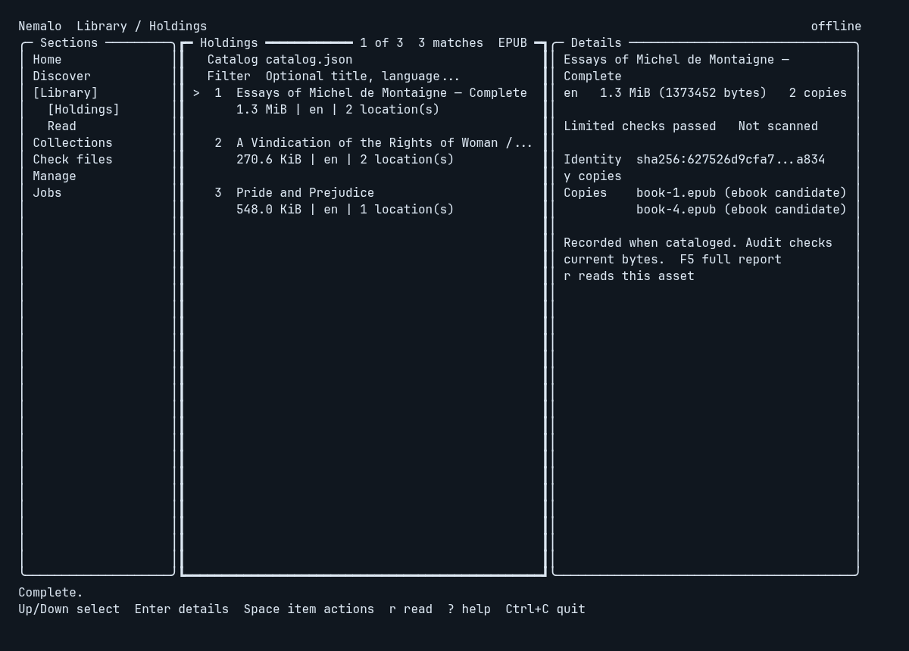

# Nemalo

**Find knowledge. Care for it. Realize its potential.**

Nemalo is an open-source, local-first library and discovery system for books,
ebooks, and audiobooks, with research papers and textbooks extending the same
collection. Find resources, evaluate sources, and care for a portable library
under your control. Pronounced **neh-MAH-lo**: acquire and nurture knowledge.

Built in Go. CLI and TUI first. Linux, macOS, and Windows. Desktop and terminal
compatibility were reviewed on Omarchy 4 (Arch Linux x86_64). No telemetry or required
AI service. The agent interface (MCP) uses the same application services.

## Status

**Early development, not 1.0.** Available today:

- Search Open Library and Internet Archive by provider relevance, or Archive by
  download count or identifier; evaluate Archive item/file metadata.
- Acquire a selected Archive EPUB, PDF, or MP3 into exclusive untrusted intake,
  with source checksums, local checks, a scan by the installed antivirus, and a
  provenance receipt. A detection is quarantined and other files are offered.
  Acquire a whole LibriVox recording in declared track order, and resume an
  interrupted download or recording without fetching completed bytes again.
- Inventory explicit folders; check file structure, size, hashes, and EPUB text
  measurements. A scan is recommended for a file you did not produce and stays
  optional: Defender on Windows, ClamAV on Linux and macOS. Pass a publisher
  SHA-256 when one exists.
- Save portable catalog snapshots, browse holdings, and audit changed/missing files.
- List and search a managed library, and open a holding in a reader or player
  through a verified read-only copy, so readers never modify stored files.
- Initialize library control state with locking and resumable initialization.
- Import one EPUB, PDF, or MP3, or a completed intake packet, into an initialized
  library. Preview writes nothing. Checked status requires a passed EPUB check
  and a recorded no-detection scan; other assessed files stay in review.
  `library ingest` imports a whole folder, including intake packets and ZIP
  members, and preserves the folder. `library cleanup` then moves sources whose
  books the library holds into a recoverable holding area, and `library restore`
  undoes it. `library rescan` scans review holdings in
  one batched command.
- Retrieve bounded EPUB text in CLI/JSON/TUI, with exact continuation, source parts,
  note references, local image bytes, and explicit extraction gaps. Illustrated
  chapters stay readable; each omitted image or table is located. PDFs read by
  physical page and printed label, with images, unmapped text, and scanned pages
  located as gaps. Exact quotations can be located by page and offset. MP3
  tracks report probed and declared timing and chapters, and return decodable
  ranges; held recordings list their tracks in order with missing positions.
- Read a held EPUB or PDF in the terminal with `nemalo read`: pages sized to
  the screen, or one word at a time at a rate you control. Nothing records
  what you read.
- Report environment paths, tool availability, scanner setup and signature age,
  and the directory descriptor bridge (/proc/self/fd on Linux, /dev/fd on macOS)
  with doctor.
- Use CLI, versioned JSON, an interactive terminal interface, or read-only MCP
  tools for an agent host (`nemalo mcp serve --scope DIRECTORY`), also packaged
  as a Claude Code plugin and an Agent Plugins package.

RAR and 7z intake, a purge for held sources,
recording identity across holdings, and MCP write tools are planned. Single-file import is not
a full checked-library policy.
File checks report limited evidence, never a safety or completeness guarantee.
See [current capabilities and limits](docs/DEVELOPMENT.md) and the [roadmap](ROADMAP.md).
Native prerelease archives and checksums are on [GitHub Releases](https://github.com/blisspixel/nemalo/releases).

## Install

Linux and macOS:

```sh
curl -fsSL https://raw.githubusercontent.com/blisspixel/nemalo/main/scripts/install.sh | sh
```

Windows PowerShell:

```powershell
irm https://raw.githubusercontent.com/blisspixel/nemalo/main/scripts/install.ps1 | iex
```

The installers fetch the newest published release archive, verify it against the
release `SHA256SUMS`, and install one executable to `~/.local/bin` or
`%LOCALAPPDATA%\Programs\nemalo`. Pass `--version`/`-Version` to pin a release and
`--uninstall`/`-Uninstall` to remove it. See
[decision 0013](docs/decisions/0013-release-installer-scripts.md).

With `nemalo` on PATH, add the read-only tools to Claude Code:

```text
/plugin marketplace add blisspixel/nemalo
/plugin install nemalo@nemalo
```

See [agent integration](docs/AGENT-INTEGRATION.md#plugin-packages).

## Quick start

```sh
nemalo doctor
nemalo tui
nemalo search "librivox frankenstein" --source archive --sort downloads --limit 5
nemalo check /path/to/book.epub --scan
```

To build from source instead, with Go 1.27.2 or a compatible supported toolchain,
run `go build -trimpath -o bin/ ./cmd/nemalo`; the binary is `bin/nemalo`
(`bin/nemalo.exe` on Windows). Run `nemalo help` for commands. Local inventory and catalog operations are offline; explicit searches
send queries to the selected provider. Sources are preserved.



Application-view render using the external validation catalog, not a mockup or an
OS window capture. See [terminal guide and discovery view](docs/TUI.md).

## Documentation

| Guide | Contents |
| --- | --- |
| [Product contract](docs/PRODUCT.md) | Vision, commitments, intended workflows, and format policies |
| [Roadmap](ROADMAP.md) | Milestones, release gates, and implemented versus planned work |
| [Operation and development](docs/DEVELOPMENT.md) | Commands, configuration, bounds, safety limits, and verification |
| [Terminal guide](docs/TUI.md) | Navigation, browsing, keyboard shortcuts, and screenshots |
| [Content access](docs/CONTENT-ACCESS.md) | EPUB excerpts, exact continuation, unsupported gaps, and remaining access work |
| [Acquisition](docs/ACQUISITION.md) | Selected downloads, intake receipts, and failure handling |
| [Architecture](docs/ARCHITECTURE.md) | Shared services, data protection, recovery, and decisions |
| [Sources](docs/SOURCES.md) | Provider directory, rights, and integration constraints |
| [Agent integration](docs/AGENT-INTEGRATION.md) | Read-only MCP server, plugin packages, and planned write tools |
| [Validation](docs/VALIDATION.md) | External 104-resource collection, evidence, and remaining gaps |
| [Research](docs/RESEARCH.md) | Evaluated patterns and primary references |
| [Releases](docs/RELEASING.md) | Packaging, checksums, and native validation requirements |

Contributing: read [AGENTS.md](AGENTS.md), then run `go run ./cmd/verify` and
`go test -race ./...` (race checks require a native C compiler).

Licensed under [Apache 2.0](LICENSE). Downloaded content retains its own rights.
