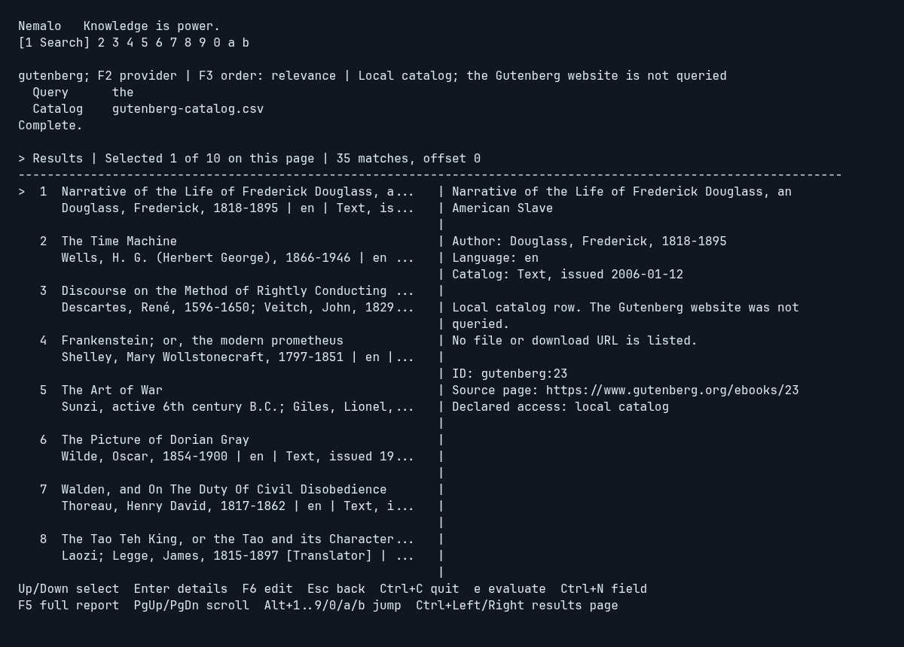
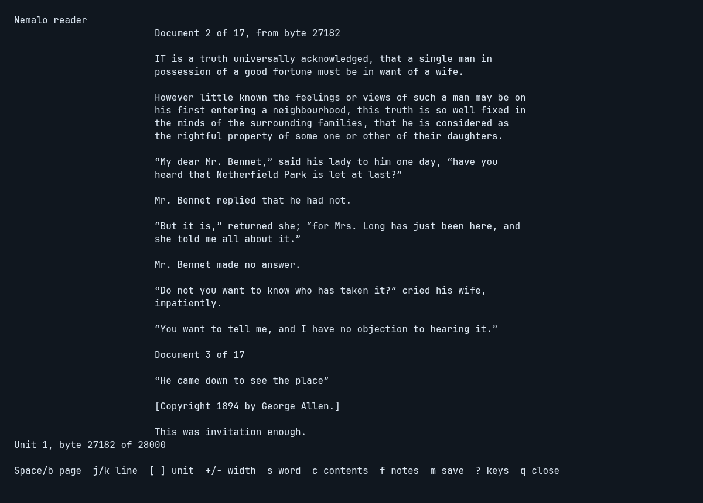

# Terminal guide

Nemalo uses the same application services as the CLI. No provider request runs at
startup. Select an operation, fill its fields, and press Enter to run it.
Results and form drafts remain with each operation for the current session.

## Browse and inspect

Search and holdings show a selectable list, with an adjacent evidence pane in
terminals at least 100 columns wide. Narrower terminals show the list; Enter in
results opens the selected item's details. F5 switches to the complete report,
including identifiers, provenance, findings, and limitations.

F6 moves focus between the form and results. A `>` marker identifies focused
fields and the selected row without relying on color. Up/Down select results;
Home/End select the first/last item on the current page. PageUp/PageDown scroll
the evidence pane or report. Escape returns from details, then to the form.
While work runs, Escape cancels it. Ctrl+C quits from anywhere.

In Archive search results, `e` fills the evaluation form with the selected item
ID. This makes no request; Enter explicitly retrieves metadata. Evaluation does
not download content, determine file-level rights, or establish safety.
Evaluation also lists source files. Enter a new Intake directory with Ctrl+N,
focus a file with F6, then `d` reviews the exact acquisition before a confirming
Enter. The download is scanned once with the installed scanner, and the status
line states the result. Downloads remain untrusted; Check/Scan are staged
afterward. After a detection the file is quarantined and the list shows the
item's other files for a new, deliberate review. See
[acquisition](ACQUISITION.md) for incomplete-packet handling and bounds.

## Commands and shortcuts

| Key | Action |
| --- | --- |
| Tab / Shift+Tab | Next / previous operation |
| Alt+1..9, Alt+0 | Jump to the numbered operation; 0 selects Read |
| Enter in form | Run the explicit operation |
| F6 | Focus results / return to editing |
| Up / Down, Home / End in results | Select an item |
| Enter in results | Toggle selected-item details |
| F5 | Toggle complete evidence report |
| PageUp / PageDown | Scroll detail/report |
| Ctrl+Left / Ctrl+Right | Previous / next search or holdings page |
| F2 in search | Switch Open Library / Internet Archive / local Gutenberg catalog |
| F3 in Archive search | Cycle relevance / downloads / identifier order |
| F3 in Gutenberg search | Cycle relevance / identifier. The website is not queried |
| F3 in inspect, snapshot, audit | Select bounded 1 GiB / 5 GiB read budget |
| F4 in holdings | Cycle EPUB / PDF / MP3 / M4B / M4A / all filename filters |
| F7 in State | Review initialization of an explicit existing folder |
| F8 in State | Review import of the folder and one source; no antivirus scan |
| Ctrl+R in State | Review a rescan of review holdings that lack scan evidence |
| Ctrl+N in two-field forms | Switch between fields, including the Gutenberg catalog and the State source |
| Ctrl+A in snapshot | Toggle historical health metadata |
| e in Archive, Gutenberg, or Open Library results | Prepare selected-item evaluation, without requesting it. A Gutenberg catalog row lists no files. An Open Library work lists editions on Enter. e on an edition row selects that edition |
| d in Evaluate results | Review selected-file acquisition into a new intake directory. An empty Intake field asks for a folder (Ctrl+N) and does not fetch. On a Gutenberg catalog row, d then requests that one bibliographic record and lists EPUB offers. After an Open Library edition names an Archive item, d reviews that Archive file |
| F9 in State | Preview moving the source folder's held files to the holding area; Enter applies that exact plan. With a cleanup ID in the source field (set after a cleanup), preview restoring it |
| Ctrl+P in State | With a cleanup ID in the source field, preview purging its held copies whose bytes the library holds and verifies; Enter removes exactly those. The library keeps its own copy |
| t in Holdings results | Show the recording that holds the selected track: order, missing tracks, timing |
| a in Evaluate results | Review acquiring every track of the recording that holds the selected MP3. An empty Intake field asks for a folder (Ctrl+N) and does not open that review |
| r in Holdings results | Stage source access; explicit root still required |
| o in managed Holdings results | Open a verified read-only copy in the default application |
| Enter in Read results | Retrieve the selected source unit |
| n / r / u in Read results | Next range / repeat last request / list units |
| c / g in Read results | List the EPUB's declared contents / declared page labels, such as iv or 42. Enter reads from the selection |
| p / s in Read results | Open as pages / one word at a time: the selected unit or entry of a listing, else where the last excerpt began, else the first unit |
| Escape | Back; cancel active work |
| Ctrl+C | Quit |

Cleanup review shows the exact member chains and held byte identities for a
nested archive. Spaces and literal separators inside names stay distinct; control
characters are shown as escapes. A changed source or selection refuses the plan.

Holdings accept a snapshot catalog file or an initialized library directory; a
library lists managed holdings, and `r` stages Read with that directory as both
catalog and root. Edited queries require Enter before paging. Holdings start with EPUB filenames;
filename filtering does not validate content. Snapshot success fills empty
holdings/audit forms but does not automatically open or audit anything.

State (operation 9) reads local control identity/status on Enter. F7 reviews the
exact folder and control-file writes; a second Enter initializes it. Ctrl+N sets
one EPUB, PDF, MP3, M4B, M4A, or completed intake packet. F8 reviews that import; a second
Enter copies it into the library without scanning; a packet whose acquisition
scan was clean and bound to the same bytes can still be recorded as checked.
Ctrl+R reviews a rescan; a second Enter scans the review holdings that lack scan
evidence and records the results. Escape, F7, F8, and Ctrl+R leave any review
without a new write. Review freezes fields/navigation and supports
PageUp/PageDown. Initialization is not import; see
[decision 0009](decisions/0009-managed-epub-import.md),
[decision 0012](decisions/0012-scan-on-acquire-quarantine-and-rescan.md), and
[the state contract](decisions/0006-library-control-state.md).

## Source access

Select a Holdings asset and press `r`. This stages Read without reading files.
Use Ctrl+N to enter the explicit source root, then Enter lists EPUB spine units.
F6 focuses the list; Enter retrieves up to 4096 structured-text bytes from the
selected unit. The report preserves lines and escapes terminal control bytes.
It reports extraction gaps and references outside the delivered range.
An MP3 holding is read as `mpeg-audio/1`: Enter lists the track's frame index,
timing, and declared chapters, and a range reports its frames, samples, and file
bytes without printing or playing audio. An M4B or M4A holding is read as
`mp4-audio/1`: Enter lists its sample table summary and each declared chapter
with its start and end. It has no ranges; `o` in Holdings opens a verified copy
in a player.

In focused Read results, `n` requests the returned continuation, `r` repeats the
last request, and `u` lists units again. `c` lists the book's declared contents.
Enter, `p`, or `s` on a resolved entry reads that entry and stops at its
declared end. Failed requests retain the previous next
reference; repeat retries the failed request. Changing catalog/root requires a
fresh units request before continuation. Switching operations preserves the
session's report and references. Nothing records reading or acknowledgement.
`m` saves a bookmark in an initialized library, and `'` restores it. Neither
runs on its own, and closing does not save. A catalog snapshot writes nothing.
The CLI exposes note/source/resource references; the TUI does not yet navigate
EPUB notes, render images, or play audio. Unsupported units fail explicitly.

## Reader

`p` or `s` in focused Read results, or `nemalo read`, opens a full-screen
reader on EPUB or PDF text ([decision 0025](decisions/0025-terminal-reading.md)).
Pages are 66 columns for EPUB and 100 for PDF, narrower on a smaller terminal.
A wrapped PDF source line continues with a hanging indent. Omitted images and
tables appear where they were omitted. A resize, or a switch between pages and
one word at a time, repaints the whole frame. `?` lists the keys. The footer
keeps `q close` visible at 80 columns.

Without a listing on screen, `p` and `s` open where the last successful
excerpt of the same asset, catalog, and root began, at its unit and byte, not
at its continuation. A failed or cancelled read does not move that place. An
excerpt of a declared entry reopens that entry there, so pages still stop at
its declared end, also after it crossed into another spine file. Only the
unit and byte move between representations, as `epub-structure/1`,
`epub-text/2`, and `epub-nav/1` share text coordinates; changed bytes are
reported by the reader's own read. Word mode opens paused.

| Key | Pages | Speed reading |
| --- | --- | --- |
| Space | Next page | Play or pause |
| PageDown, Right, l, n | Next page | Right, l: next sentence |
| b, PageUp, Left, h | Previous page | Left, h: previous sentence |
| j, Down / k, Up | One line down / up | Slower / faster by 25 |
| - / + | Narrower / wider | Slower / faster by 25 |
| g / G | Start / end of the loaded text | |
| [ / ] | Previous / next unit. Inside a declared entry, these stay in that entry | Previous / next unit. Inside a declared entry, these stay in that entry |
| s / p | s: speed reading from this page | p: pages at this word |
| m | Save this location. Closing does not save | Save this location. Closing does not save |
| ' | Restore the saved location | Restore the saved location |
| f | Links and notes on this page | Pause, then links and notes near this word |
| Escape | Close, or in a note go back one level | Close, or in a note go back one level |
| q | Close. Nothing is saved | Close. Nothing is saved |
| ? | Show or hide the key list. `q close` stays in the footer at 80 columns | Show or hide the key list. `q close` stays in the footer at 80 columns |

Speed reading starts paused at 250 words per minute and holds sentence ends
twice as long. Above 350 the footer calls it skimming, since comprehension fell
at those rates in studies. Paused, the surrounding rows show the word marked.
An unreadable unit stops reading when you reach it, after everything already
delivered; `]` opens the next unit. A session holds up to 4 MiB of text; at
that limit `]` continues from the same place in a new session.
Closing shows one line, such as `Closed at Chapter One, 12% through. Nothing
about this reading was recorded.`, and keeps the exact unit and byte in the F5
full report. It mentions a bookmark only when one is saved for the book at
another place, since closing never moves it. `m` saves only
when bookmarks are enabled on an initialized library.

`f` lists the EPUB links on the page, from `epub-structure/1`. A link the
source declares with `epub:type="noteref"` is a note reference; any other is
listed as a link and is not presumed to be a note. Each shows its status: in
the book, links back, missing, outside the reading order, or outside the book
and never fetched. Enter follows a link in the book and reads only its target
part; when the target is a short marker such as a `[1]` anchor, the part it
sits in is shown and the note says so. Space continues a long note within its
part, never into the next one. `f` in a note lists its links, up to four
notes deep. Escape goes back one level and returns to the same place in the
passage, paused in word mode; the passage's session is never replaced. `m`
and `'` keep to the passage: in a note they say so and write nothing. PDF
text has no links to follow.

## Appearance and boundaries

Colours are the terminal's own ANSI colours, so the terminal theme sets their
shade and their contrast on its background: blue for the brand, selected mode,
and headings; green for done (imported, verified, checked); yellow for active
work, reviews, and results that need attention; red for failures and
detections; dim for context and hints. No truecolor value is emitted and the
background is not queried. The status line's colour is the operation's
outcome, read from its result, never from the status wording, and every
outcome also has explicit text. `NO_COLOR` and `TERM=dumb` disable styling. Minimum size is 40 columns by 20 rows; state survives
the resize prompt. No image, animation, or color is required for navigation.
Mode labels keep their number and name together: when every name does not
fit, the other modes show their numbers and the selected mode keeps its name.
Field hints and the context line end at a whole word with `...`; each mode's
empty view keeps the full explanation. The footer is one line when it fits.
The reader names the unit in its header except where the page opens on that
unit's own heading.
Omarchy's Super shortcuts and F9 dictation binding do not take Nemalo's Alt+1
through Alt+0, F2 through F8, or Ctrl+C keys. See
[operation and limits](DEVELOPMENT.md).

Full reports remain accessible when compact browsing truncates a title. Catalog
assessment is historical; audit current bytes before relying on identity. A scan
is recommended for a file you did not produce. It stays explicit, and the
installed scanner's cloud/sample policy applies. A no-detection result is not
proof the file is safe. See
[operation and limits](DEVELOPMENT.md) for the full capability boundaries.

## Application-view captures

These are rendered terminal frames from the actual Go application model, using
the real external catalog and live Archive results, captured 2026-10-08. They are
not OS screenshots or mockups. Downloaded content and private paths are excluded.

