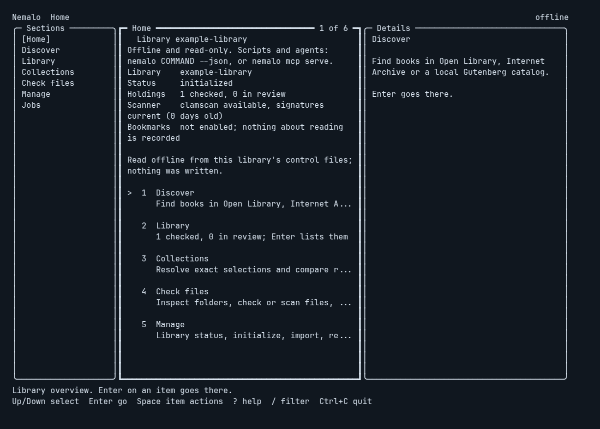
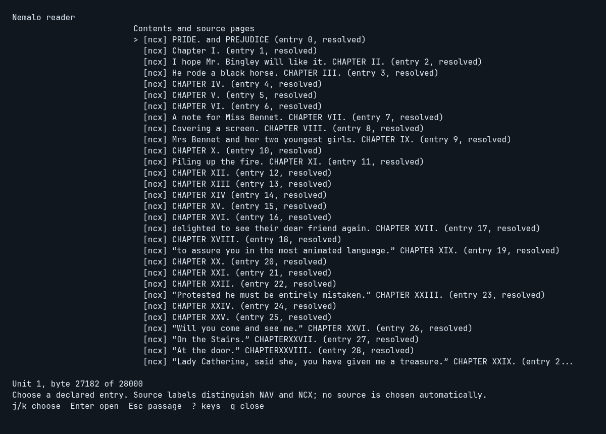
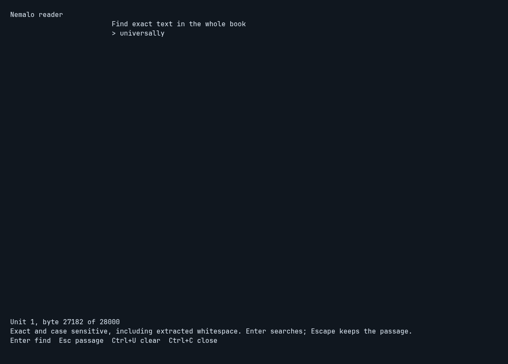
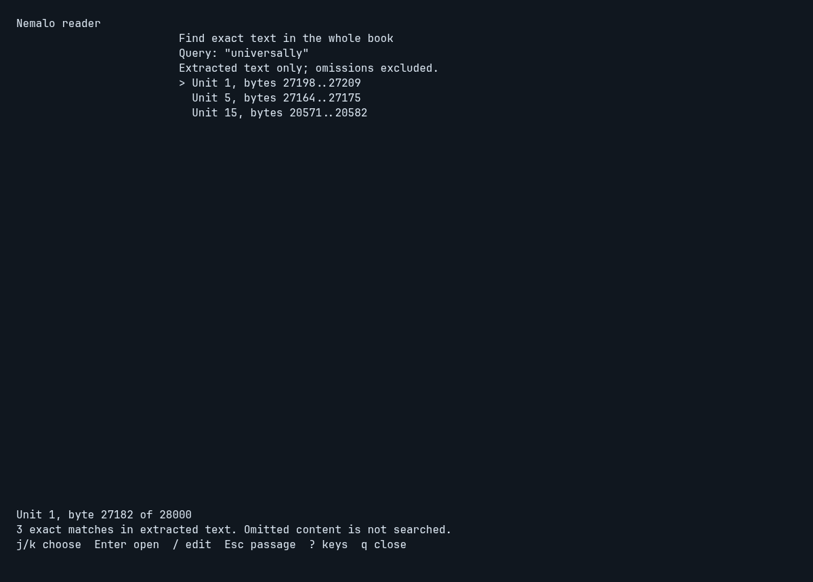
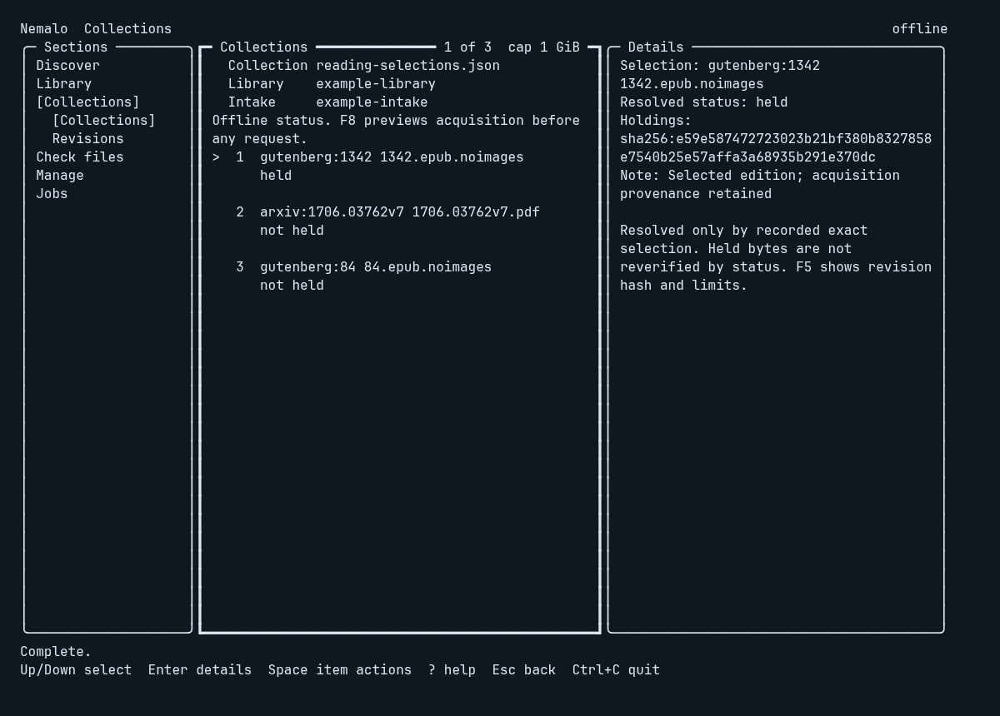
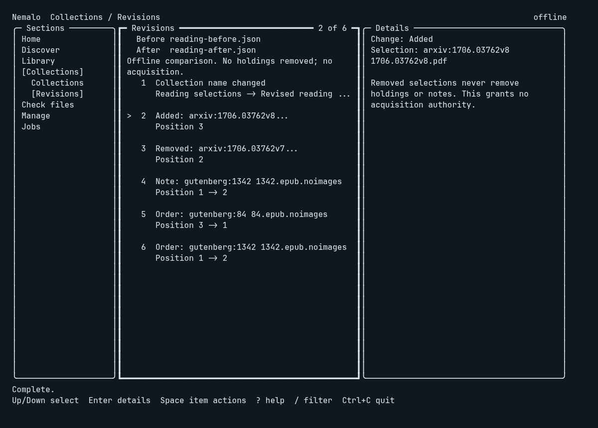
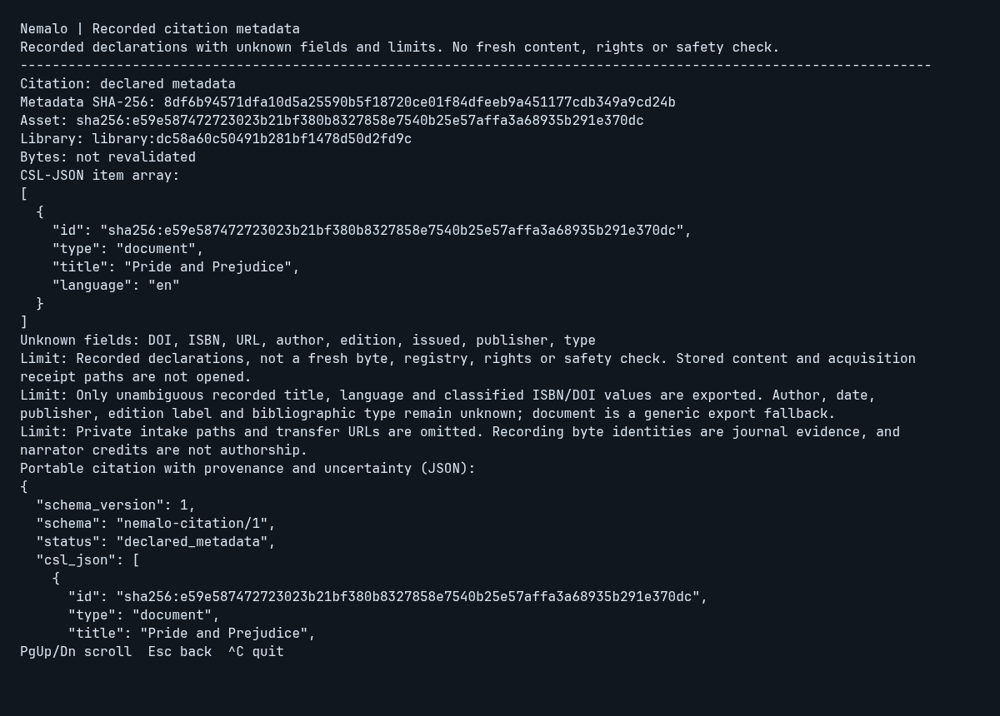
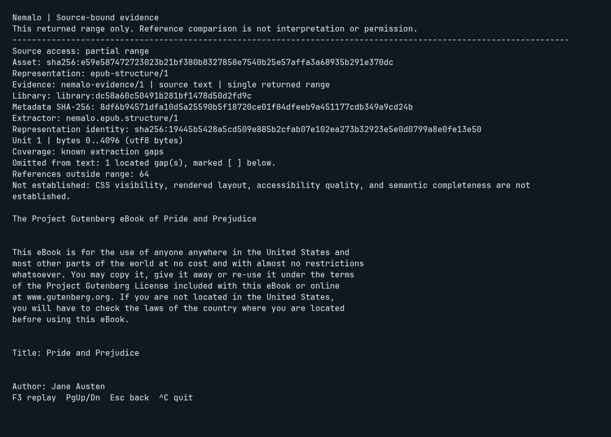
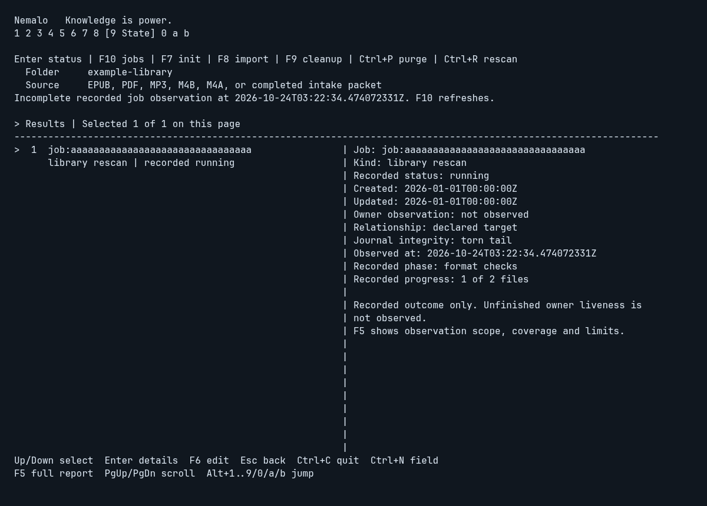

# Terminal guide

Nemalo uses the same application services as the CLI. No provider request runs at
startup. Operations are steps grouped into sections named for what you come to do:

| Section | Steps |
| --- | --- |
| Home | Library overview, saved bookmarks, first-run choices |
| Discover | Search, Evaluate |
| Library | Holdings, Read |
| Collections | Collections, Revisions |
| Check files | Inspect, Check, Scan, Snapshot, Audit |
| Manage | Status (initialize, import, rescan, clean up, restore, purge) |
| Jobs | Recorded jobs |

Fill a step's fields and press Enter to run it. Results and form drafts remain
with each step for the current session.

Nemalo opens on Home. The library resolved as for the CLI (`--library`,
`NEMALO_LIBRARY`, then `library` in `config.json`) prefills Home, Holdings, Read,
Status, Jobs, Audit and the Collections library field; every field stays
editable. With a configured library Home reads an offline overview at startup:
control status, holdings checked and in review, scanner availability from the
same lookups as `nemalo doctor` (no scan runs), saved bookmarks and recorded
jobs. It writes nothing, reads nothing more from a folder that is not an
initialized library, and Escape cancels it. Each explicit bookmark is a Continue
entry that Enter opens in Read; nothing else about reading is shown or inferred.
Section entries go there on Enter, and Library lists the holdings. Without a
library, Home offers three starts: find a public-domain book, look at files you
already have, or set up a library folder
([decision 0102](decisions/0102-home-overview-and-detail-cards.md)). Write-review controls use physical
keystrokes. A committed text string spelling `enter`, `esc` or another control
name cannot confirm or dismiss a review.

At 100 columns and wider a Sections sidebar lists every section, with the current
section's steps under it. Narrower terminals name the sections on the header row
and the current section's steps in the panel title. The current section and step
are bracketed, so location never depends on colour. Panels have titled borders;
the focused panel's border is heavy, and `>` marks the focused field or row. The
footer shows at most six keys for the focused part of the screen
([decision 0101](decisions/0101-task-sections-and-action-registry.md)).

`Ctrl+O` opens a palette of every action in every section, searchable as you
type: `acq` finds the acquisition reviews and `jobs` the Jobs step. The current
step's available actions come first. Unavailable actions are dim and say why,
network actions are marked `network`, and actions that open a write review are
marked `review`. Up and Down choose, Enter runs, and Escape or `Ctrl+O` closes.
An action that runs on Enter, uses the network, or writes without a review only
moves to its step and names the key to press. A chosen review still asks for its
own Enter. With results focused, Space lists the selected item's actions, `?`
shows every key grouped by section, and `:` also opens the palette; in a text
field these keys are typed. In the evidence report, `r` replays as F3 does. Text
fields use the terminal's real cursor at the edit position, and the palette puts
it on the chosen row, so screen magnifiers and screen readers that follow the
cursor can track it ([decision 0094](decisions/0094-terminal-keyboard-and-cursor-access.md)).

`nemalo tui --plain`, or `TERM=dumb`, keeps a linear layout without borders or a
sidebar: a location line, the context line, the fields, status, position and
content, in that order. For linear reading with a screen reader,
`nemalo content read` without `--json` prints a located passage and its next
step as plain lines.

## Browse and inspect

Search and holdings show a selectable list, with an adjacent Details panel in
terminals at least 100 columns wide. Holdings, search results, evaluation files
and jobs share one card: title, a line of facts, status chips taken from typed
values, a short identity (the first 12 and last 4 characters), aligned lists and
one dim caveat line, with each fact shown once. A missing or partial scan is
never shown as clean. `y` sends the selected item's full identity to the
terminal clipboard with OSC 52; a terminal can ignore that silently, so the
status says the request was sent and F5 still shows the full value. Narrower terminals show the list; Enter in
results opens the selected item's details. F5 switches to the complete report,
including identifiers, provenance, findings, and limitations.

F6 moves focus between the form and results. A `>` marker identifies focused
fields and the selected row without relying on color. Up/Down select results;
Home/End select the first/last item on the current page. PageUp/PageDown scroll
the evidence pane or report. Escape returns from details, then to the form.
While work runs, Escape cancels it. Ctrl+C quits from anywhere.

Rows show a title clipped at a whole word, a right-aligned size or format, and a
dim line of languages, copies and status; the panel title shows the absolute
position, such as `12 of 340`. With results focused, `/` filters the loaded page
as you type, offline: Enter keeps the filter, `/` edits it, and Escape restores
the full page and its selection. Down past the last item continues to the next
page and Up past the first to the previous one. Holdings and a local Gutenberg
catalog load at once; a network provider shows a "Load the next page (network)"
row, and only Enter on it sends the request
([decision 0103](decisions/0103-list-filter-paging-and-mouse.md)).

Finished work reports its outcome in words from the typed result, such as
`Imported Essays as review (unscanned).` or a scan's "no detections reported (not
proof of safety)". Running work shows elapsed time and its phase; a single-file or
recording acquisition also shows a byte bar that stops at 99% until the result.
A toast with the outcome word appears at the right of the footer: others fade
after five seconds, failures stay until the next key. `L` with results focused
shows every message of the session with its time, in memory only.
`NEMALO_REDUCE_MOTION`, `--plain` and `TERM=dumb` remove the spinner and toasts
and change the busy line at most every five seconds
([decision 0104](decisions/0104-terminal-feedback.md)).

The details of a held EPUB show its declared cover in a 14 by 10 column beside
the card, in Kitty and Ghostty (Kitty graphics with Unicode placeholders). The
cover is read only when the details open, from the EPUB's own `cover-image` or
EPUB 2 cover declaration, never from a provider and never by guessing a file.
Only JPEG, PNG and GIF are decoded, and images over 4096 pixels a side or 8
megapixels are refused from their header. Thumbnails stay in memory for the
session, and the image is removed from the terminal when the details close, the
step changes, the window resizes and at exit. Everywhere else, including WezTerm,
iTerm2, foot, Windows Terminal, tmux, screen, `NO_COLOR` and fewer than 256
colours, a title card of the same size stands in, and a `Cover` line says why.
`"covers": "off"` in config.json or `NEMALO_COVERS=off` turns covers off; plain
mode shows neither
([decision 0105](decisions/0105-local-epub-covers.md)).

In the panel layout a click) selects a row or opens a section or step, the wheel
moves the selection or scrolls, and a double click is Enter. Plain mode does not
take the mouse, so the terminal keeps its own text selection; most terminals
also select text with Shift held. Every action stays on the keyboard.

In Archive search results, `e` fills the evaluation form with the selected item
ID. This makes no request; Enter explicitly retrieves metadata. Evaluation does
not download content, determine file-level rights, or establish safety.
Evaluation also lists source files. Enter a new Intake directory with Ctrl+N,
focus a file with F6, then `d` reviews the exact acquisition before a confirming
Enter. The download is scanned once with the installed scanner, and the status
line states the result. Downloads remain untrusted; Check/Scan are staged
afterward. After a detection the file is quarantined and the list shows the
item's other files for a new, deliberate review. See
[acquisition](ACQUISITION.md) for incomplete-packet handling and bounds.

## Commands and shortcuts

| Key | Action |
| --- | --- |
| Tab / Shift+Tab | Next / previous step, in section order |
| Alt+1..9, Alt+0 | Search, Inspect, Check, Scan, Snapshot, Holdings, Audit, Evaluate, Status, Read |
| Alt+A / Alt+B | Collections / collection Revisions. Jobs has no Alt key; use Tab or the palette |
| Ctrl+O | Searchable palette of every action |
| Space / ? / : in results | Selected item's actions / every key / the palette |
| y in results | Copy the selected item's full identity (OSC 52) |
| Enter in Home results | Go to the selected section, or open the selected bookmark in Read |
| Enter in form | Run the explicit operation |
| F6 | Focus results / return to editing |
| Up / Down, Home / End in results | Select an item |
| Enter in results | Toggle selected-item details |
| F5 | Toggle complete operation report |
| PageUp / PageDown | Scroll detail/report |
| Ctrl+Left / Ctrl+Right | Previous / next search or holdings page |
| / in results | Filter the loaded page as you type, offline; Enter keeps, Escape restores |
| L in results | This session's messages, with times |
| Down past the last item / Up past the first | Next / previous page: local pages load, network pages wait for Enter on their own row |
| F2 in search | Switch Open Library / Internet Archive / local Gutenberg catalog |
| F3 in Archive search | Cycle relevance / downloads / identifier order |
| F3 in Gutenberg search | Cycle relevance / identifier. The website is not queried |
| F3 in inspect, snapshot, audit | Select bounded 1 GiB / 5 GiB read budget |
| F3 in Collections | Select a 1 GiB / 5 GiB total acquisition transfer cap; this does not fetch |
| F4 in holdings | Cycle EPUB / PDF / MP3 / M4B / M4A / all filename filters |
| F7 in Status | Review initialization of an explicit existing folder |
| F8 in Status | Review import of the folder and one source; no antivirus scan |
| F8 in Collections | Preview acquisition offline, then review the bound request before a separate confirming Enter permits network and intake writes |
| Ctrl+R in Status | Review a rescan of review holdings that lack scan evidence |
| F10 in Status or Jobs, Enter in Jobs | Observe bounded recorded jobs for the selected existing library, without reconciliation, polling or job cancellation |
| Ctrl+N in two-field forms | Switch between fields, including the Gutenberg catalog and the Status source |
| Ctrl+N in Collections | Cycle collection file, initialized library and absolute outside intake |
| Ctrl+A in snapshot | Toggle historical health metadata |
| e in Archive, Gutenberg, or Open Library results | Prepare selected-item evaluation, without requesting it. A Gutenberg catalog row lists no files. An Open Library work lists editions on Enter. e on an edition row selects that edition |
| d in Evaluate results | Review selected-file acquisition into a new intake directory. An empty Intake field asks for a folder (Ctrl+N) and does not fetch. On a Gutenberg catalog row, d then requests that one bibliographic record and lists EPUB offers. After an Open Library edition names an Archive item, d reviews that Archive file |
| F9 in Status | Preview moving the source folder's held files to the holding area; Enter applies that exact plan. With a cleanup ID in the source field (set after a cleanup), preview restoring it |
| Ctrl+P in Status | With a cleanup ID in the source field, preview purging its held copies whose bytes the library holds and verifies; Enter removes exactly those. The library keeps its own copy |
| t in Holdings results | Show the recording that holds the selected track: order, missing tracks, timing |
| a in Evaluate results | Review acquiring every track of the recording that holds the selected MP3. An empty Intake field asks for a folder (Ctrl+N) and does not open that review |
| r in Holdings results | Stage source access; explicit root still required |
| o in managed Holdings results | Open a verified read-only copy in the default application |
| Enter in Read results | Retrieve the selected source unit |
| n / r / u in Read results | Next range / repeat last request / list units |
| c / g in Read results | List the EPUB's declared contents / declared page labels, such as iv or 42. Enter reads from the selection |
| F2 / F4 in Read | Recorded citation metadata / evidence for the last successful bounded excerpt |
| p / s in Read results | Open as pages / one word at a time: the selected unit or entry of a listing, else where the last excerpt began, else the first unit |
| Escape | Back; cancel active work |
| Ctrl+C | Quit |

Cleanup review shows the exact member chains and held byte identities for a
nested archive. Spaces and literal separators inside names stay distinct; control
characters are shown as escapes. A changed source or selection refuses the plan.

Holdings accept a snapshot catalog file or an initialized library directory; a
library lists managed holdings, and `r` stages Read with that directory as both
catalog and root. Edited queries require Enter before paging. Holdings start with EPUB filenames;
filename filtering does not validate content. Snapshot success fills empty
holdings/audit forms but does not automatically open or audit anything.

Status (Manage, Alt+9) reads local control identity/status on Enter. F7 reviews the
exact folder and control-file writes; a second Enter initializes it. Ctrl+N sets
one EPUB, PDF, MP3, M4B, M4A, or completed intake packet. F8 reviews that import; a second
Enter copies it into the library without scanning; a packet whose acquisition
scan was clean and bound to the same bytes can still be recorded as checked.
Ctrl+R reviews a rescan; a second Enter scans the review holdings that lack scan
evidence and records the results. Escape, F7, F8, and Ctrl+R leave any review
without a new write. Review freezes fields/navigation and supports
PageUp/PageDown. Initialization is not import; see
[decision 0009](decisions/0009-managed-epub-import.md),
[decision 0012](decisions/0012-scan-on-acquire-quarantine-and-rescan.md), and
[the state contract](decisions/0006-library-control-state.md).

F10 in Status, or Enter in the Jobs step, observes recent selected-library job
relationships through the same passive snapshot service as `nemalo jobs snapshot`.
It reads only on that explicit key: opening Status or Jobs, changing focus and
resizing do not poll. Results label recorded
outcomes and unobserved ownership; a recorded running job can be abandoned.
F6 and Enter browse summaries/details, and F5 shows coverage and limitations.
An incomplete observation is marked for attention. Escape cancels an observation;
results from a cancelled generation cannot replace a later selection.
Missing state stays missing, and jobs, holdings and disabled bookmarks stay
unchanged. The action neither starts nor cancels jobs, probes owners, imports
content or opens a stored asset. Enter in the Status form still reads library status.
The [snapshot contract](decisions/0088-non-mutating-library-job-snapshot.md)
defines its relationships, bounds and legacy omissions.

## Collections and revisions

Alt+A opens Collections. Enter an exact-selection collection JSON file and an
existing initialized library, using Ctrl+N to move fields. Enter resolves holdings
offline. F6 browses declarations, resolved status, recording coverage and held asset
identities; F5 shows the collection hash and all limitations. Status does not verify
stored bytes, initialize the library, fetch a provider or save reading activity.

The third field is an absolute intake outside the library. F8 previews its existing
packets and missing selections offline, preserving missing intake. When a transfer
can start, the review shows exact selections, collection hash, library identity,
packet actions, byte caps and scanner policy. Enter confirms that frozen request;
Escape returns to the preview without acquisition. Review blocks other keys and
input. A changed collection, library, missing selection, packet action or budget
requires a fresh review through the shared application guard. Per-source checks
still run freshly; the preview does not freeze concurrent filesystem changes.

The total transfer cap starts at 1 GiB; F3 deliberately selects 5 GiB. A recording
uses the same cap, and the whole run has a 30-minute deadline. Missing or failed
scanning stays explicit, and detections use quarantine. Downloads remain untrusted
intake; ingest is separate. Escape cancels active work and preserves started
packets. Receipted packets await ingest; retained attempts stay untouched and do
not offer another transfer. Passive requests have a 15-second deadline, generation
fences and no polling. No new MCP acquisition tool or collection store is added.

Alt+B opens Revisions. Enter the before and after collection files; no library is
required. The offline comparison separates exact additions/removals, name and note
changes, and relative-order changes. F6 browses changes, and F5 shows both file
hashes and the complete report. Removed selections never remove holdings, sources
or bookmark notes. The comparison does not authorize acquisition. Form drafts and
reports remain in session when changing operations.

See [collections](decisions/0050-collections.md),
[revision semantics](decisions/0053-collection-revision-previews.md) and
[bound acquisition review](decisions/0089-collection-acquisition-review.md).

## Source access

Select a Holdings asset and press `r`. This stages Read without reading files.
Use Ctrl+N to enter the explicit source root, then Enter lists EPUB spine units.
F6 focuses the list; Enter retrieves up to 4096 structured-text bytes from the
selected unit. The report preserves lines and escapes terminal control bytes.
It reports extraction gaps and references outside the delivered range.
An MP3 holding is read as `mpeg-audio/1`: Enter lists the track's frame index,
timing, and declared chapters, and a range reports its frames, samples, and file
bytes without printing or playing audio. An M4B or M4A holding is read as
`mp4-audio/1`: Enter lists its sample table summary and each declared chapter
with its start and end. It has no ranges; `o` in Holdings opens a verified copy
in a player.

In focused Read results, `n` requests the returned continuation, `r` repeats the
last request, and `u` lists units again. `c` lists the book's declared contents.
Enter, `p`, or `s` on a resolved entry reads that entry and stops at its
declared end. Failed requests retain the previous next
reference; repeat retries the failed request. Changing catalog/root requires a
fresh units request before continuation. Switching operations preserves the
session's report and references. Nothing records reading or acknowledgement.
`m` saves a bookmark in an initialized library, and `'` restores it. Neither
runs on its own, and closing does not save. A catalog snapshot writes nothing.
The excerpt report exposes note references; the full-screen reader below follows
supported EPUB links and notes. Neither view renders image pixels or plays audio.
The CLI also exposes original source and bounded resource bytes. Unsupported
units fail explicitly.

## Citation and source evidence

In Read, F2 explicitly opens recorded citation metadata for the selected managed
holding. It includes CSL-JSON, provenance, unknown or ambiguous fields and limits;
stored content is not opened or freshly checked. F4 explicitly repeats the last
successful bounded excerpt with source-bound evidence. It shows exact identities,
the returned range, declared metadata, coverage gaps, limits and the portable
evidence JSON. A units listing is not an excerpt. A new listing, failed/cancelled
read, bookmark restore or changed asset/catalog/root requires another successful
excerpt before F4. Ordinary snapshot reading still works, but these two shared
services require a managed library.
For machine-readable export, use the corresponding CLI command with `--json`;
line wrapping in the terminal report is presentation.

The separate report retains the ordinary passage, continuation, location, drafts,
list selection and scroll position. PageUp/PageDown or arrows scroll; Home/End
choose the report's beginning/end. Escape cancels and returns; Ctrl+C quits.
F3 in a completed evidence report deliberately replays the same captured bounded
request and returned reference. It does not follow a continuation. Failure discards
the response payload and old token. Physical control keys own this report; paste
and committed text cannot edit forms, switch modes or trigger replay.

No request runs automatically. Citation has a 15-second deadline; evidence keeps
the shared five-minute maximum and existing inner limits. Both are offline and
read-only. They save no position, history or bookmark, enable no decoder and make
no interpretation, whole-work coverage, rights or safety guarantee. MP4 remains
units-only in the TUI. See [decision 0090](decisions/0090-terminal-cited-evidence.md).

## Reader

`p` or `s` in focused Read results, or `nemalo read`, opens a full-screen
reader on EPUB or PDF text ([decision 0025](decisions/0025-terminal-reading.md)).
Pages are 66 columns for EPUB and 100 for PDF, narrower on a smaller terminal.
A wrapped PDF source line continues with a hanging indent. Omitted images and
tables appear where they were omitted. A resize, or a switch between pages and
one word at a time, repaints the whole frame. `?` lists the keys. The footer
keeps `q close` visible at 80 columns.

Without a listing on screen, `p` and `s` open where the last successful
excerpt of the same asset, catalog, and root began, at its unit and byte, not
at its continuation. A failed or cancelled read does not move that place. An
excerpt of a declared entry reopens that entry there, so pages still stop at
its declared end, also after it crossed into another spine file. Only the
unit and byte move between representations, as `epub-structure/1`,
`epub-text/2`, and `epub-nav/1` share text coordinates; changed bytes are
reported by the reader's own read. Word mode opens paused.

| Key | Pages | Speed reading |
| --- | --- | --- |
| Space | Next page | Play or pause |
| PageDown, Right, l, n | Next page | Right, l: next sentence |
| b, PageUp, Left, h | Previous page | Left, h: previous sentence |
| j, Down / k, Up | One line down / up | Slower / faster by 25 |
| - / + | Narrower / wider | Slower / faster by 25 |
| g / G | Start / end of the loaded text | |
| [ / ] | Previous / next unit. Inside a declared entry, these stay in that entry | Previous / next unit. Inside a declared entry, these stay in that entry |
| s / p | s: paused word mode; return to the same word after page context unless you navigated | p: page context at this word, paused |
| c | Choose declared contents or a physical PDF page | Pause and open the same chooser |
| / | Find exact text in the whole book | Pause and open the same search dialog |
| m | Save this location. Closing does not save | Save this location. Closing does not save |
| ' | Restore the saved location | Restore the saved location |
| f | Links and notes on this page | Pause, then links and notes near this word |
| Escape | Close; in a note or contents, return to the passage | Close; in a note or contents, return to the passage |
| q | Close. Nothing is saved | Close. Nothing is saved |
| ? | Show or hide the key list. `q close` stays in the footer at 80 columns | Pause and show the key list; hiding it stays paused until Space |

`c` opens the contents chooser inside the reader. EPUB NAV and NCX entries stay
separately labeled, including duplicate labels and unresolved declarations.
Use j/k or arrows, Space/b or PageDown/PageUp, and g/G or Home/End to choose;
Enter opens that exact source entry, paused, until its declared end. An unresolved
entry is refused. PDF choices are physical pages with any declared page label.
The display holds at most 2048 choices and says when it reaches that limit.
Escape or c returns to the unchanged passage, paused; q closes the reader.
Opening or closing the chooser records no progress and changes no bookmark.
Retrieval runs only on explicit open, with a 15-second deadline and cancellation
and late-result guards. Missing or failed contents stay explicit.

`/` finds exact, case-sensitive text across the book's supported extracted text,
including text outside the current declared entry. Enter searches; Escape keeps
the original passage paused. Query letters such as q and m remain text while
editing; Ctrl+U clears, and Ctrl+C closes the reader. Input is one line, at most
1000 UTF-8 bytes. Oversized, multiline, control or replacement-character input is
refused without truncation. Format characters remain literal in the query and
are displayed as visible escapes. Case, Unicode and extracted whitespace are not
normalized; multiline quotations remain available through `content locate`.

Results show at most 100 source text spans, with truncation and unsupported-content
coverage explicit. Omitted material is not searched. Use j/k, arrows, paging or
g/G to select; Enter revalidates the returned source reference and opens that exact
match in a new paused text session. The former chapter boundary does not constrain
this whole-book selection. `/` edits the query again. Escape returns to the original
passage before choosing a match. Missing, changed or stale references fail without
falling back to offsets. Queries and reading positions are not saved. Work runs
only on explicit submission with a 15-second deadline and cancellation/session guards.

Speed reading starts paused at 250 words per minute and holds sentence ends
twice as long. Above 350 the footer calls it skimming, since comprehension fell
at those rates in studies. Paused, the surrounding rows show the word marked.
An unreadable unit stops reading when you reach it, after everything already
delivered; `]` opens the next unit. A session holds up to 4 MiB of text; at
that limit `]` continues from the same place in a new session.
Closing shows one line, such as `Closed at Chapter One, 12% through. Nothing
about this reading was recorded.`, and keeps the exact unit and byte in the F5
full report. It mentions a bookmark only when one is saved for the book at
another place, since closing never moves it. `m` saves only
when bookmarks are enabled on an initialized library.

`f` lists the EPUB links on the page, from `epub-structure/1`. A link the
source declares with `epub:type="noteref"` is a note reference; any other is
listed as a link and is not presumed to be a note. Each shows its status: in
the book, links back, missing, outside the reading order, or outside the book
and never fetched. Enter follows a link in the book and reads only its target
part; when the target is a short marker such as a `[1]` anchor, the part it
sits in is shown and the note says so. Space continues a long note within its
part, never into the next one. `f` in a note lists its links, up to four
notes deep. Escape goes back one level and returns to the same place in the
passage, paused in word mode; the passage's session is never replaced. `m`
and `'` keep to the passage: in a note they say so and write nothing. PDF
text has no links to follow.

## Appearance and boundaries

Colours are the terminal's own ANSI colours, so the terminal theme sets their
shade and their contrast on its background: blue for the brand, the current
section and step, focus and headings; green for done (imported, verified,
checked); yellow for active work, reviews, and results that need attention; red
for failures and detections; cyan for actions that use the network; dim for
context and hints. No truecolor value is emitted and the
background is not queried. The status line's colour is the operation's
outcome, read from its result, never from the status wording, and every
outcome also has explicit text. `NO_COLOR` and `TERM=dumb` disable styling;
`TERM=dumb` also selects the plain layout. Minimum size is 40 columns by 20 rows;
state survives the resize prompt. No image, animation, or color is required for
navigation. Section names stay whole and wrap below 80 columns. Field hints end
at a whole word with `...`; each step's empty view keeps the full explanation,
and its standing limit (such as scanner policy or an offline comparison) stays
under its form. The footer is always one line.
The reader names the unit in its header except where the page opens on that
unit's own heading.
Omarchy's Super shortcuts and F9 dictation binding do not take Nemalo's Alt+1
through Alt+0, F2 through F8, or Ctrl+C keys. See
[operation and limits](DEVELOPMENT.md).

Full reports remain accessible when compact browsing truncates a title. Catalog
assessment is historical; audit current bytes before relying on identity. A scan
is recommended for a file you did not produce. It stays explicit, and the
installed scanner's cloud/sample policy applies. A no-detection result is not
proof the file is safe. See
[operation and limits](DEVELOPMENT.md) for the full capability boundaries.

## Application-view captures

These application-view captures were refreshed on 2026-10-24 from the current Go
TUI model at 116 columns and 36 rows, in its supported no-color mode. The Holdings,
Discovery, Jobs, Collections and Revisions views were refreshed on 2026-10-27 from
the same inputs after the section and panel frame and the detail cards (decisions
0101 and 0102), and the Home view was added; the reader, citation and evidence
views are unchanged. Home reads the managed capture library with a real
`doctor` scanner lookup; its displayed library path is a portable alias. Frames are
rendered as fixed-width text to PNG; they are not OS window screenshots.
Holdings come from a fresh offline snapshot of validation copies of Montaigne's
essays, A Vindication of the Rights of Woman and Pride and Prejudice. Five files
resolve to three exact-byte assets; the repeated copies remain visible as locations.
Discovery searches the checked-in Gutenberg catalog subset locally, without a
provider request. Reading uses the actual source-bound terminal reader over
Pride and Prejudice. Displayed catalog/root names are portable aliases; private
paths are excluded. Capture work runs no scanner, acquires no files and changes
no existing library. The captures demonstrate these views, not every workflow.
The Jobs step uses synthetic canonical state with disabled bookmarks and an
abandoned recorded running job with a torn tail. Its observation timestamp and
uncertain owner stay distinct from the older recorded progress. Repeated
observations preserve the fixture bytes; the view does not start a scan.

The Collections view resolves a copied, previously acquired public-domain EPUB
against a synthetic selection file. The Revisions view compares two synthetic
declarations, including distinct paper versions; it does not query or confirm an
upstream version. Their displayed form paths are documentation examples. Holdings
resolution and declaration changes do not establish current rights or availability.

Citation and evidence use another fresh managed library holding the same public
Pride and Prejudice bytes. They show recorded declarations and a successful
bounded source excerpt, including coverage limitations and explicit replay. Import
for these captures requested no scanner; the holding stays in review. The views
neither promote it nor infer missing bibliographic fields. The complete portable
sidecars continue below the displayed screen.

